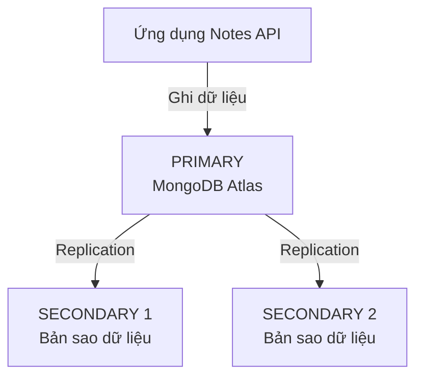
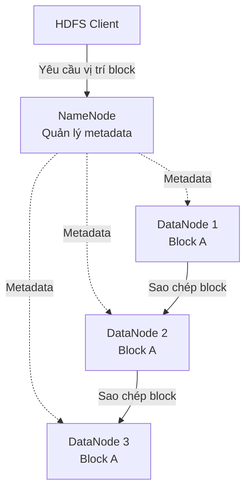

# BÀI 3 – SO SÁNH MONGODB ATLAS VÀ HDFS

## 1. MongoDB Atlas – Replica Set 3 nút

## 2. Hadoop HDFS – Replication Factor = 3

## 3. So sánh

| Tiêu chí | MongoDB Atlas | Hadoop HDFS |
|---|---|---|
| Đơn vị nhân bản | Dữ liệu trong replica set | Block dữ liệu |
| Thành phần | Primary, Secondary | NameNode, DataNode |
| Mục tiêu | Sẵn sàng, chịu lỗi | Chịu lỗi, phân tán tệp |
| Số bản sao | 3 nút | 3 bản sao mỗi block |

## 4. Nhận xét

Cả hai đều dùng nhân bản để tăng khả năng
chịu lỗi và duy trì dữ liệu khi nút gặp sự cố.

MongoDB Atlas nhân bản dữ liệu giữa các
thành viên của replica set.

HDFS chia tệp thành các block và lưu
nhiều bản sao block trên các DataNode.
NameNode quản lý metadata thay vì lưu
trực tiếp các bản sao block.
